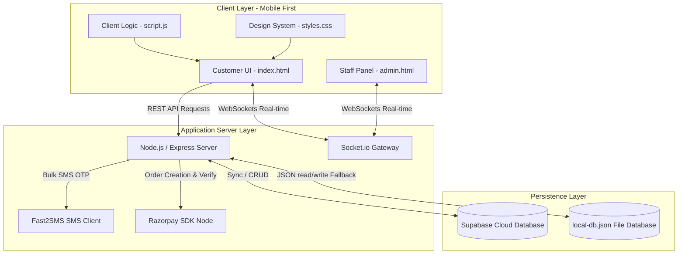

# SOFTWARE PROJECT REPORT
## Smart Dining Queue & Table Reservation System

> [!NOTE]
> This project report is prepared for final year BCA/BSc/BTech project submission. It provides a comprehensive technical overview, architecture diagram, API structure, database design, and workflow analysis of the Smart Dining Queue & Table Reservation System.

---

## 1. Project Overview

### 1.1 Purpose
The **Smart Dining Queue & Table Reservation System** is a mobile-first, real-time web application designed to digitize and optimize the restaurant dining experience. By integrating virtual queuing, remote table booking, self-service food ordering, and payment gateway features, the system bridges the gap between customer convenience and restaurant operational efficiency.

### 1.2 The Problem in Restaurants & Food Courts
Traditional dine-in and food court experiences suffer from several systemic bottlenecks:
- **Congested Waiting Areas:** Customers have to stand in physical lines for tables or food collection, leading to overcrowding and a poor dining atmosphere.
- **Inaccurate Wait Times:** Manual queuing makes it difficult for host staff to estimate waiting times, leading to customer frustration.
- **Double Bookings & Empty Tables:** Manual reservation systems on paper ledgers often lead to double bookings, scheduling conflicts, or tables sitting idle due to no-shows.
- **In-person Order Delays:** Taking orders manually via paper tickets introduces human error, kitchen delays, and billing friction.
- **Payment Processing Overhead:** Handling cash or card machines at the counter increases wait times during peak hours.

### 1.3 Benefits of the System
| Benefit Dimension | For Customers | For Administrators / Staff |
| :--- | :--- | :--- |
| **Time & Convenience** | • Virtual queue registration from anywhere.<br>• Real-time queue position tracking.<br>• Advance table booking with best-fit recommendation. | • Automated customer sequence management.<br>• Streamlined reservation log without manual sheets. |
| **Operational Efficiency** | • Direct digital self-ordering via cart system.<br>• Immediate status tracking of order stages. | • Real-time order tracking dashboard.<br>• Automated kitchen workflow status transitions. |
| **Financial Security** | • Multiple payment methods (Razorpay Online / Cash Verification). | • Reduced billing errors.<br>• Secure payment verification using HMAC signatures. |
| **Resource Management** | • Clear view of table availability. | • Double-booking prevention via automated overlap calculations. |

---

## 2. Project Objectives

The system was designed and implemented with the following key objectives:
1. **Reduce Customer Wait Times:** Implement virtual queuing to let customers wait productively elsewhere rather than standing in physical queues.
2. **Automate Table Allocation:** Build a real-time reservation module that suggests the best-fitting tables based on party size.
3. **Streamline Kitchen Operations:** Create a live order pipeline (Pending -> Sent to Kitchen -> Cooking -> Ready -> Served) to coordinate kitchen and front-of-house staff.
4. **Implement Real-time Synchronization:** Leverage WebSockets (Socket.io) to ensure updates (order status, queue calls, reservations) sync instantly across customer devices and the staff panel.
5. **Ensure Robust Offline Fallback:** Create a dual-persistence layer (Supabase Cloud + Local file JSON) to guarantee business continuity if the internet is disconnected.

---

## 3. Technology Stack

The project utilizes a modern client-server-database architecture tailored for real-time mobile web usage.



### 3.1 Frontend Technologies
- **HTML5:** Semantic structural markup optimized for mobile views.
- **CSS3 (Custom styling):** Implements a dark-mode palette, premium gradients, micro-interactions, glassmorphic headers/cards, and responsive layouts.
- **JavaScript (ES6+):** Handles dynamic page transitions (views), local storage states, socket event listeners, and payment trigger handlers.
- **Remix Icons & Google Font Outfit:** Visual styling elements providing a clean typography and consistent design system.
- **Razorpay Checkout SDK:** Client-side payment script injected dynamically to display the native Razorpay payment modal.

### 3.2 Backend Technologies
- **Node.js:** Server runtime environment hosting the application code.
- **Express.js:** Web server framework providing HTTP endpoints for SMS routing, payment verification, health checks, and static asset delivery.
- **Socket.io (Server-side):** Manages connection channels, event loops, and broadcasts status changes to active client connections.

### 3.3 Database & Integration APIs
- **Supabase (PostgreSQL):** Cloud-hosted relational database for storing master tables. Enables SQL query executions and row updates.
- **PostgreSQL Realtime Replication:** Replicates mutations (`INSERT`, `UPDATE`) in the cloud database down to the Socket.io server to sync views.
- **File System Fallback (`local-db.json`):** Node `fs` driven storage acting as a local database fallback when database connections fail.
- **Fast2SMS API:** SMS gateway integration to dispatch 6-digit verification codes to Indian mobile phone numbers.
- **Razorpay API:** Processes secure payments using API keys, creating orders on Razorpay's servers and verifying webhook responses with SHA-256 HMAC signatures.

---

## 4. NPM Packages Used

The application dependency list from `package.json` contains packages selected for specific performance and security goals:

| Package Name | Version | Role in the System | Rationale for Selection |
| :--- | :--- | :--- | :--- |
| **`express`** | `^5.2.1` | HTTP web server. | Standard framework for hosting endpoints and serving files in Node.js. |
| **`socket.io`** | `^4.8.3` | WebSocket real-time communication. | High-performance, low-latency framework supporting fallback options like HTTP long-polling. |
| **`@supabase/supabase-js`** | `^2.105.4` | DB connection and operations. | Official client to interact with PostgreSQL, supporting connection pools and authentication. |
| **`razorpay`** | `^2.9.6` | Online payment order management. | Official server SDK to safely communicate with Razorpay APIs without exposing API keys on the frontend. |
| **`cors`** | `^2.8.6` | Cross-Origin resource management. | Prevents browser security blocks when running local servers across different ports. |
| **`dotenv`** | `^17.4.2` | Configuration environment manager. | Isolates sensitive variables (API tokens, database secrets, database keys) from source control. |
| **`vite`** | `^8.0.12` | Build and dev environment manager. | Provides fast bundling, hot module reloading, and efficient asset compilation. |

---

## 5. System Architecture

The Smart Dining system utilizes a **Client-Server-Database Architecture** with real-time websocket synchronization.

### 5.1 Presentation Layer (Frontend Clients)
The presentation layer is composed of two primary interfaces:
1. **Customer Web App (`index.html`):** A responsive interface mimicking a native mobile application. Contains client-side routing logic via view switches (toggling the `.active` class on `<section>` elements).
2. **Staff Dashboard (`admin.html`):** A view-constrained dashboard for restaurant operations. Uses password protection (PIN: 1234) and separates workflows into Food Orders, Queues, and Table Bookings.

### 5.2 Application Layer (Backend Server)
The Node.js Express server is the coordinating hub:
- **API Gateways:** Exposes endpoints like `/api/send-otp`, `/api/verify-otp`, `/api/payment/order`, `/api/payment/verify`, and `/api/health`.
- **Socket Event Engine:** Processes client events (`new_order`, `join_queue`, `new_reservation`, `update_order_status`, `call_queue`, `confirm_reservation`, `complete_reservation`) and broadcasts updates.
- **Data Mapper Engine:** Standardizes database payloads to clean JS structures before sending them to clients.

### 5.3 Database & Sync Layer
- **Cloud Database (Supabase PostgreSQL):** Acts as the main data store. Holds tables for orders, queues, reservations, and authenticated users.
- **Local Persistence Fallback:** If cloud connections fail, the backend reads/writes to `local-db.json`. When internet connectivity is restored, the `sync-to-supabase.js` script maps local updates and pushes them to Supabase via `upsert` queries on conflicts.

---

## 6. Features

### 6.1 Customer-Side Features
- **OTP Login System:** Users enter their 10-digit mobile number, receive a 6-digit SMS code, and log in securely. Credentials persist in the browser's `localStorage`.
- **Dynamic Digital Menu:** Features search capabilities, categorized filtering (Idli, Dosa, Rice, Sweets, etc.), live pricing, and visual food representations.
- **Dine-In Cart System:** Dynamic cart summary calculating subtotals, 5% GST, and total payable amounts. Supports adding special cooking instructions.
- **Multi-Mode Checkout:** Allows online checkouts using Razorpay (UPI, Credit/Debit Cards, NetBanking) or cash payment via a staff-provided validation code.
- **Live Order Tracking Timeline:** Displays preparation progress (Pending -> Sent to Kitchen -> Cooking -> Ready -> Served) in real time using CSS keyframe pulse rings and active state indicators.
- **Interactive Reservation Screen:** Interactive table picker grid showing real-time table statuses (Available, Reserved). Pre-selects the "Best Fit" table based on party size.
- **Virtual Queue Ticket:** Displays the token number, current position in queue, total waiting count, and estimated wait time (5 minutes per party ahead).

### 6.2 Admin-Side (Staff) Features
- **Dashboard Security PIN Gate:** Protects operational data with a staff PIN check.
- **Kitchen Order Pipeline Manager:** Displays order tickets sorted by time. Staff can transition order statuses using action buttons (e.g. clicking "Start Cooking" transitions status to "Cooking").
- **Live Queue Broadcaster:** Shows customer tokens in order of arrival. Staff can select "Table Ready (Call In)" to update status to "Called", sending a WebSocket notification to the client's screen.
- **Reservation Manager:** Displays incoming reservations. Helps resolve waitlist status conflicts by showing table booking timelines and preventing double bookings.

---

## 7. OTP Verification Module

### 7.1 Architecture & Flow
```
[User App]                           [Backend Server]                 [Fast2SMS Gateway]
    |                                       |                                 |
    |---- 1. Submit Mobile Number --------->|                                 |
    |                                       |---- 2. Generate 6-Digit OTP ----|
    |                                       |---- 3. Cache OTP (Phone -> OTP) |
    |                                       |---- 4. Post to SMS API -------->|
    |                                       |                                 |---- 5. Deliver SMS to Phone
    |                                       |<--- 6. Return API Response -----|
    |<--- 7. Render OTP Verification UI ----|                                 |
    |                                       |                                 |
    |---- 8. Input & Submit 6-digit OTP --->|                                 |
    |                                       |---- 9. Verify OTP Cache Match---|
    |                                       |-- 10. (If Match) Clear Cache -- |
    |                                       |-- 11. Upsert User in Supabase --|
    |<--- 12. Return Success Payload -------|                                 |
```

### 7.2 Security Measures
1. **In-Memory Cache Isolation:** OTPs are cached in a local JS object (`otpCache`) on the server. They are not stored in logs or clients, making it difficult to intercept them.
2. **Immediate Destruction on Success:** The OTP mapping is immediately deleted from server memory (`delete otpCache[phone]`) upon verification, preventing replay attacks.
3. **Restricted Input Formats:** The UI uses six separate single-character input boxes with focus shifting logic, restricting inputs to numeric keystrokes.
4. **Bypass Protection:** Includes a developer backdoor (`9999999999`) for testing purposes, routing directly to the dashboard during offline operations without calling external APIs.

---

## 8. Real-Time Queue Management

The queue tracking module relies on WebSocket connections to ensure updates are propagated instantly between the staff dashboard and customers.

### 8.1 Step-by-Step Position Sync
1. **Registration:** A customer enters their name and phone number on the UI, generating a queue token (e.g. `Q-532`).
2. **Socket Emitter:** The client emits `join_queue` with the queue payload to the server.
3. **Database & Cache Sync:** The server records the entry in Supabase (falling back to `local-db.json` if offline) and queries the active queue list.
4. **Broadcast Update:** The server calls `io.emit('state_update', { type: 'queues', data: queues })`.
5. **Real-time Calculations:** All connected client applications receive the update:
   - The customer's browser parses the list, sorts it by creation time, and determines the index of their token:
     $$\text{Position} = \text{Waiting Index} + 1$$
     $$\text{Est. Wait Time} = \text{Waiting Index} \times 5 \text{ minutes}$$
   - The staff dashboard updates the queue table to display the new queue card.
6. **Queue Call:** When the staff clicks "Table Ready", the server processes a `call_queue` socket event, updates the database status to `Called`, and broadcasts the update. The customer's UI highlights the token card and displays: *"It's your turn! Please proceed to the counter."*

---

## 9. Database Design

### 9.1 Database Schema (Supabase PostgreSQL)

```
                       DATABASE TABLES SCHEMA
                       
    +-------------------------------------------------------------+
    |                        users                                |
    +-------------------------------------------------------------+
    | phone (PK)          | TEXT          | User primary key      |
    | last_login          | TIMESTAMPTZ   | Last login timestamp  |
    | created_at          | TIMESTAMPTZ   | Registration time     |
    +-------------------------------------------------------------+
                                 |
                                 | phone (FK relationship logic)
                                 v
    +-------------------------------------------------------------+
    |                        queues                               |
    +-------------------------------------------------------------+
    | token (PK)          | TEXT          | Queue token (e.g. Q-123|
    | name                | TEXT          | Customer name         |
    | phone               | TEXT          | Phone number          |
    | guests              | INTEGER       | Number of guests      |
    | status              | TEXT          | Waiting/Called        |
    | created_at          | TIMESTAMPTZ   | Timestamp             |
    +-------------------------------------------------------------+
                                 |
                                 | queue_token (FK logic)
                                 v
    +-------------------------------------------------------------+
    |                        orders                               |
    +-------------------------------------------------------------+
    | id (PK)             | TEXT          | Order ID (ORD-1234)   |
    | type                | TEXT          | Dine-In / Takeaway    |
    | members             | INTEGER       | Number of members     |
    | items               | JSONB         | Ordered dishes list   |
    | total               | INTEGER       | Total amount (INR)    |
    | method              | TEXT          | Cash / Online         |
    | status              | TEXT          | Order workflow status |
    | order_time          | TEXT          | Display order time    |
    | queue_token         | TEXT          | Associated queue token|
    | table_number        | INTEGER       | Assigned table number |
    | created_at          | TIMESTAMPTZ   | Creation timestamp    |
    +-------------------------------------------------------------+
                                 ^
                                 | table_number (FK logic)
                                 |
    +-------------------------------------------------------------+
    |                     reservations                            |
    +-------------------------------------------------------------+
    | id (PK)             | TEXT          | Booking ID (RES-1234) |
    | name                | TEXT          | Customer name         |
    | booking_date        | TEXT          | YYYY-MM-DD            |
    | booking_time        | TEXT          | HH:MM AM/PM           |
    | guests              | INTEGER       | Number of guests      |
    | table_number        | INTEGER       | Selected table ID     |
    | status              | TEXT          | Confirmed / Waitlist  |
    | created_at          | TIMESTAMPTZ   | Timestamp             |
    +-------------------------------------------------------------+
```

### 9.2 Table Definitions

#### Table: `public.users`
Used to manage client session access:
- `phone` (TEXT, Primary Key): Unique contact phone number.
- `last_login` (TIMESTAMPTZ, default `now()`): Record of user login activity.
- `created_at` (TIMESTAMPTZ, default `now()`): Creation date of user record.

#### Table: `public.queues`
Manages virtual queuing status:
- `token` (TEXT, Primary Key): Token ID (e.g. `Q-831`).
- `name` (TEXT): Customer display name.
- `phone` (TEXT): Customer mobile number.
- `guests` (INTEGER, default `1`): Party size.
- `status` (TEXT, default `'Waiting'`): State of queue token (`Waiting` / `Called`).
- `created_at` (TIMESTAMPTZ, default `now()`): Placement order timestamp.

#### Table: `public.reservations`
Manages table bookings:
- `id` (TEXT, Primary Key): Booking identifier (e.g. `RES-4039`).
- `name` (TEXT): Booking name.
- `booking_date` (TEXT): Date selected by client.
- `booking_time` (TEXT): Time slot requested (e.g. `07:15 PM`).
- `guests` (INTEGER, default `1`): Number of seats requested.
- `table_number` (INTEGER, Nullable): Reserved table ID.
- `status` (TEXT, default `'Confirmed'`): State of reservation (`Confirmed` / `Waitlist` / `Completed`).
- `created_at` (TIMESTAMPTZ, default `now()`): Creation timestamp.

#### Table: `public.orders`
Logs self-service orders:
- `id` (TEXT, Primary Key): Order identifier (e.g. `ORD-8412`).
- `type` (TEXT, default `'Dine-In'`): Dine-In, Takeaway, or Table Dine-In.
- `members` (INTEGER, default `1`): Dining party size.
- `items` (JSONB, default `'[]'`): JSON array containing item list descriptions and quantities.
- `total` (INTEGER): Total cost of the order in INR.
- `method` (TEXT): Payment tracking mode.
- `status` (TEXT, default `'Pending'`): Pipeline status (`Pending` / `Sent to Kitchen` / `Cooking` / `Ready` / `Served`).
- `order_time` (TEXT): Formatting string of order time.
- `queue_token` (TEXT, Nullable): Associated queue token for takeaways.
- `table_number` (INTEGER, Nullable): Assigned dining table ID.
- `created_at` (TIMESTAMPTZ, default `now()`): Database transaction time.

---

## 10. User Interface Design

### 10.1 UI Style System
- **Matte Black Dark Theme:** Utilizes deep background colors (`#000000`) paired with subtle cards (`#111111`) to create a premium visual experience.
- **Glassmorphic Elements:** Headers, bottom navigation menus, and sheets use transparent backgrounds (`rgba(17, 17, 17, 0.8)`) with blur filters (`backdrop-filter: blur(24px)`) and fine borders (`#222222`).
- **Responsive Mobile Layouts:** Restricts desktop displays using standard CSS media queries (`@media (min-width: 1025px)`) and displays a fallback warning screen, focusing design resources on mobile and tablet form factors.

### 10.2 Component Analysis

#### Customer Portal Screens
1. **User Login View:** Step-by-step verification card. Contains numeric mobile inputs and custom verification code fields.
2. **Main Dashboard (Entry View):** Large options cards displaying graphic icons for key workflows: "Join Live Queue", "Book a Table", and "Order Food Live".
3. **Dynamic Menu Grid:** Shows categories as swipeable horizontal pill buttons (`.category-scroll`). Displays food products as cards with image wraps, pricing details, preparation speed statistics, and order quantity toggles.
4. **Interactive Reservation Calendar:** Date inputs, time selectors, guest count options, and a visual grid of table cards. Best-fit tables based on party size are highlighted with a badge.
5. **Timeline Order Tracker:** Uses custom CSS line guides to connect steps. Completed steps are highlighted in orange, while the active step is highlighted with a pulse animation.

#### Staff Portal Dashboard
- **PIN Authorization Gate:** Password input screen protecting operational views.
- **Tab Layout Engine:** Controls switches to view food orders, queue items, and table bookings.
- **Dynamic Action Elements:** State transitions are implemented as action buttons. For example, staff can click "Mark Ready" to update order preparation states instantly.

---

## 11. Project Workflow

```
[Customer App]                      [Unified Backend]                  [Staff Dashboard]
      |                                     |                                  |
      |--- 1. Logs in via OTP ------------->|                                  |
      |                                     |                                  |
      |--- 2. Book Table / Join Queue ----->|                                  |
      |                                     |---- 3. Broadcast Sync App ------>|
      |                                     |                                  |--- 4. Approves / Confirms
      |<-- 5. Receives Live Status ---------|                                  |
      |                                     |                                  |
      |--- 6. Selects Items & Pays -------->|                                  |
      |                                     |---- 7. Notifies Kitchen -------->|
      |                                     |                                  |--- 8. Prepares & Sets Ready
      |<-- 9. Real-time Status Tracker -----|                                  |
      |                                     |                                  |
      |--- 10. Served & Completed --------->|                                  |
```

### 11.1 Comprehensive Execution Walkthrough
1. **Login & Authenticate:**
   - The customer enters their phone number and logs in using the OTP sent to their mobile device. The phone number is stored in local storage to keep the session active.
2. **Select Dining Preference:**
   - **Scenario A (Join Virtual Queue):** The user enters their name on the queue form. The server creates a token and assigns a queue position, estimating wait times in real time.
   - **Scenario B (Table Reservation):** The user enters booking date/time parameters and selects an available table. The system checks for scheduling conflicts before confirming the booking.
   - **Scenario C (Order Food Live):** The user browses the menu, adds items to their cart, and inputs special requests.
3. **Submit Order & Process Payment:**
   - **Online Mode:** The app fetches dynamic transaction scripts from Razorpay, opens a payment gateway interface, completes the transaction, and verifies the response signature on the server.
   - **Cash Mode:** The customer enters a verification code provided by host staff, prompting the server to approve the transaction.
4. **Kitchen Processing (Real-time Status Updates):**
   - The backend server processes the order and emits a `new_order` event via WebSockets to the staff panel.
   - Kitchen staff update the order status as it moves through preparation steps:
     `Pending` $\rightarrow$ `Sent to Kitchen` $\rightarrow$ `Cooking` $\rightarrow$ `Ready` $\rightarrow$ `Served`.
   - Each state transition is broadcast to the customer's device in real time, updating the visual progress tracker on their screen.
5. **Dine-In Completion:**
   - Once the order status is set to `Served` (or the reservation is marked as `Completed`), the active order tracker is cleared, completing the service loop.

---

## 12. Security Features

The application implements security practices across frontend, backend, and database layers:

1. **HMAC-SHA256 Payment Verification:** Online payments are protected against tampering by generating secure validation signatures on the server using the merchant secret key:
   $$\text{Signature} = \text{HMAC-SHA256}(\text{order\_id} + \text{"|"} + \text{payment\_id}, \text{RAZORPAY\_KEY\_SECRET})$$
   The transaction is approved only if this signature matches the one returned by the client.
2. **Database Access Roles:** The backend accesses Supabase using the service role key, bypassing standard Row Level Security (RLS) rules. This ensures client requests are mediated by server-side verification logic rather than allowing direct database mutations from the browser.
3. **Staff Access Gate:** Crucial administrative functions are protected behind a login PIN checked on the server, preventing unauthorized access.
4. **Transient Cache OTPs:** OTPs are stored in volatile server memory instead of persistent databases and are deleted immediately after verification to prevent replay attacks.

---

## 13. Advantages

- **Improved Front-of-House Management:** Virtual queues eliminate crowded waiting areas, improving the dining atmosphere and customer experience.
- **Accurate Customer Service Estimations:** System-generated position trackers provide realistic wait time updates.
- **Optimized Seating Capacity:** Interactive table selections and best-fit algorithms ensure seating capacity is used efficiently.
- **Increased Operations Throughput:** Direct digital self-ordering reduces the time staff spend taking orders and processing payments manually.
- **Offline Reliability:** If internet access is lost, local JSON persistence fallbacks ensure the restaurant can continue operating and sync data later.

---

## 14. Limitations

- **Local Persistence Write Conflicts:** The offline fallback mechanism uses simple JSON reads and writes on disk. In high-traffic environments, simultaneous file writes can lead to file lock errors or data overwrites.
- **Static Authentication Pin:** Staff panel authentication relies on a single shared access PIN, which lacks individual user accountability.
- **Geographic SMS Constraints:** The Fast2SMS API integration is restricted to Indian country codes and format regulations, requiring modifications for international phone numbers.
- **Local Storage Reliance:** Customer sessions and active history logs are saved in browser local storage. Cleared caches can remove historical data logs.

---

## 15. Future Enhancements

- **AI-Based Wait Time Estimation:** Implement machine learning algorithms that analyze historical orders and kitchen capacity to predict wait times more accurately.
- **Scan-to-Order QR Codes:** Place unique QR codes on tables to automatically verify table numbers and direct customers to order pages.
- **Automated WhatsApp Notifications:** Send updates and table alerts directly to customers' WhatsApp numbers.
- **Centralized Multi-Branch Dashboard:** Add support for multiple branches with centralized menu management and branch performance analytics.
- **Enhanced Staff Metrics:** Add reporting tools for table turnover speeds, top-selling menu items, and peak service hours.

---

## 16. Conclusion

The **Smart Dining Queue & Table Reservation System** successfully addresses key operational bottlenecks in the restaurant industry. By combining real-time communication technologies (Socket.io) with cloud databases (Supabase) and offline fallback mechanisms, it creates a reliable and efficient platform for both customers and staff. The mobile-first design, secure payment integrations, and automated table allocation rules provide a modern solution that improves operational efficiency and the customer experience. This project demonstrates how modern web development frameworks and real-time syncing mechanisms can be applied to solve real-world service industry challenges.

---

## 17. PPT Content (Slide-by-Slide)

Here is a slide-by-slide presentation outline for final project reviews:

### Slide 1: Title & Presentation Details
- **Slide Title:** Smart Dining Queue & Table Reservation System
- **Subtitle:** A Real-time, Offline-Resilient Mobile Ordering & Queue Platform
- **Presenter Name:** [Helvin]
- **Project Context:** Final Year Project Presentation (BTech / BCA / BSc)

### Slide 2: The Problem Statement
- **Key Points:**
  - Inefficient physical waiting queues during peak dining hours.
  - Manual paper ledger booking systems lead to double-booking conflicts.
  - Slow order taking and checkout workflows at dining tables.
  - Operational downtime during network or internet outages.

### Slide 3: Project Objectives
- **Key Points:**
  - Create a mobile-first portal for remote virtual queuing and table bookings.
  - Develop a real-time tracking pipeline for kitchen orders and queue calls.
  - Implement secure payment gateways (Razorpay Online + Cash Verification).
  - Ensure offline resilience using a local JSON database fallback.

### Slide 4: System Architecture
- **Key Points:**
  - Diagram showing relationship between presentation clients, API gateways, WebSockets, and database persistence layers.
  - Highlights real-time data sync using Socket.io and PostgreSQL replication.

### Slide 5: Core Technology Stack
- **Key Points:**
  - **Frontend:** HTML5, Custom CSS3, ES6+ Javascript, Remix Icons.
  - **Backend Server:** Node.js, Express.js.
  - **Real-time Engine:** Socket.io WebSockets.
  - **Database:** Supabase (Cloud PostgreSQL) + `local-db.json` (Local fallback).
  - **Integrations:** Fast2SMS (OTP Delivery), Razorpay SDK (Online payments).

### Slide 6: OTP & User Authentication Module
- **Key Points:**
  - Secure verification code generation and volatile cache logic.
  - Integration with the Fast2SMS gateway.
  - Immediate cache cleanup on success and user logs inside Supabase.

### Slide 7: Real-Time Queue Operations
- **Key Points:**
  - Virtual token generation.
  - Wait time estimation based on queue position.
  - Staff "Call In" notification broadcasts via Socket.io.

### Slide 8: Interactive Table Booking Engine
- **Key Points:**
  - Real-time table status updates (Available / Reserved).
  - Overlap check algorithms to prevent double-booking conflicts.
  - Party size matching with "Best Fit" table highlights.

### Slide 9: Self-Service Order & Payment Flows
- **Key Points:**
  - Digital menu browsing with search and categorized filtering.
  - Double checkout modes: Razorpay UPI/Cards online or Cash Verification.
  - HMAC SHA-256 signature verification on the server for secure payments.

### Slide 10: Kitchen Order Pipeline Management
- **Key Points:**
  - Staff portal order tracking list.
  - Simple status transitions (Pending -> Cooking -> Ready -> Served).
  - Active tracking timelines with status-specific icons and progress indicators.

### Slide 11: Supabase Database Schema
- **Key Points:**
  - Overview of database tables: `users`, `queues`, `reservations`, `orders`.
  - Explanations of table relationships, indexes, and replication publications.

### Slide 12: Offline Fallback & Sync Mechanism
- **Key Points:**
  - Graceful fallback to `local-db.json` on disk during network drops.
  - Dedicated script (`sync-to-supabase.js`) to sync local changes when connection is restored.

### Slide 13: Project Advantages
- **Key Points:**
  - Reduced wait times and less crowded waiting areas.
  - Faster table turnover and order processing.
  - Secure payment handling.
  - Reliable offline failover.

### Slide 14: Project Limitations & Future Scope
- **Key Points:**
  - **Limitations:** Single shared PIN for staff access, simple JSON file locks.
  - **Future Scope:** AI wait time estimations, scan-to-order QR codes, WhatsApp notifications.

### Slide 15: Conclusion & Acknowledgements
- **Key Points:**
  - Successful implementation of a real-time, offline-resilient dining platform.
  - Summary of technical achievements.
  - Thank you slide with Q&A session prompt.

---

## 18. Viva Questions & Answers

### Q1: What is the primary purpose of this system?
**Answer:** The system digitizes restaurant operations by providing virtual queue tokens, advance table reservations, self-service food ordering, and secure payment processing in a unified, real-time web application.

### Q2: What architecture is used in this project?
**Answer:** It uses a Client-Server-Database Architecture. The frontend (HTML/CSS/JS) communicates with a Node.js Express backend using REST APIs for transactions and WebSockets (Socket.io) for real-time state synchronization, backed by Supabase PostgreSQL.

### Q3: How does the virtual queue system calculate wait times?
**Answer:** The client app calculates the waiting index by sorting active queue entries by creation date. It then calculates the wait time by multiplying the number of people ahead of the user by 5 minutes:
$$\text{Wait Time} = \text{Index} \times 5 \text{ minutes}$$

### Q4: What database technology is used, and how does it sync?
**Answer:** The primary database is Supabase PostgreSQL. The system uses a local JSON file (`local-db.json`) as a backup if the connection drops. The `sync-to-supabase.js` script handles data synchronization once the connection is restored.

### Q5: How are double bookings prevented in the table reservation module?
**Answer:** When a reservation request is submitted, the server compares the requested date, time, and table ID against existing confirmed bookings. If a booking exists within a 1-hour window, the new request is assigned to the `Waitlist` status instead of being confirmed.

### Q6: What is the role of Socket.io in this project?
**Answer:** Socket.io establishes a WebSocket connection between the clients and server, allowing real-time bidirectional communication. It is used to broadcast queue updates, order status changes, and new reservations instantly.

### Q7: How does the OTP login module work?
**Answer:** When a user submits their phone number, the server generates a 6-digit verification code, caches it, and dispatches it via the Fast2SMS gateway. Once the user submits the code, the server compares it with the cache. If they match, the session is approved and recorded in the database.

### Q8: Where is the user's login session stored on the client side?
**Answer:** The verified phone number is saved in the browser's `localStorage`. During startup, the client checks for this value to restore the session and bypass the login screen.

### Q9: How does the system handle online payments securely?
**Answer:** The backend uses the Razorpay SDK to create payment orders. Once the transaction is complete, the client returns payment IDs and signatures. The backend verifies the signature using HMAC-SHA256 and the merchant secret key before approving the order:
$$\text{Signature} = \text{HMAC-SHA256}(\text{order\_id} + \text{"|"} + \text{payment\_id}, \text{RAZORPAY\_KEY\_SECRET})$$

### Q10: What is the purpose of the `sync-to-supabase.js` script?
**Answer:** It is a standalone synchronization script that reads offline entries recorded in `local-db.json` and uses the Supabase client to upload them to the cloud database using PostgreSQL `upsert` queries to prevent duplicates.

### Q11: Explain the order status pipeline stages.
**Answer:** Orders move through five sequential stages:
1. `Pending` (order placed and unpaid/awaiting confirmation)
2. `Sent to Kitchen` (sent to kitchen display)
3. `Cooking` (chef is preparing the items)
4. `Ready` (ready for pickup or table service)
5. `Served` (delivered, completing the order workflow)

### Q12: How are static files served in the application?
**Answer:** The Express server uses static middleware (`express.static`) to serve asset folders like `/Image` and files like `script.js` and `styles.css` directly to clients.

### Q13: What API routing parameters are used for OTP verification?
**Answer:** The backend uses two Express POST API endpoints:
- `/api/send-otp`: Generates and sends the OTP.
- `/api/verify-otp`: Validates the client's OTP code.

### Q14: How does the table suggestion algorithm choose the "Best Fit" table?
**Answer:** It compares the party size against table capacities. A table is flagged as a "Best Fit" if its capacity is greater than or equal to the guest count and the difference is 2 seats or fewer, avoiding assigning large tables to small parties.

### Q15: How does the server authenticate staff access?
**Answer:** The staff interface requires a PIN (set to `1234`). When verified, the frontend initializes the Socket.io connection and displays the dashboard interface.

### Q16: How does the system display responsive web screens on mobile?
**Answer:** The application uses custom CSS media queries. If the screen width exceeds 1024px, the app hides the interface and displays a warning message advising the user to open the application on a mobile device.

### Q17: What are the main tables in the database schema?
**Answer:**
1. `users` (manages phone login records)
2. `queues` (tracks active virtual queue tokens)
3. `reservations` (manages table bookings)
4. `orders` (stores ordered items, totals, and statuses)

### Q18: What is glassmorphic design, and how is it used here?
**Answer:** It is a design style featuring semi-transparent elements with a frosted-glass look. The application implements this using transparent background colors combined with backdrop filter blurs:
```css
background: rgba(17, 17, 17, 0.8);
backdrop-filter: blur(24px);
border: 1px solid #222222;
```

### Q19: Why was Supabase selected over traditional SQL/NoSQL databases?
**Answer:** Supabase provides a managed PostgreSQL database with built-in real-time replication features, allowing the system to sync changes immediately without requiring custom database triggers.

### Q20: What happens if a user inputs an incorrect OTP?
**Answer:** The server compares the submitted OTP with the cached value. If they do not match, the server returns an HTTP 400 Bad Request error. The UI catches this response, displays a validation error message, and retains the inputs.

### Q21: How does the database track transaction times?
**Answer:** Each table schema includes a `created_at` column configured with a PostgreSQL timestamp datatype (`timestamptz`) that defaults to the system time (`now()`), ensuring consistent timestamps.

### Q22: What happens if the Fast2SMS key is missing in `.env`?
**Answer:** The backend prints a warning message to the server logs and displays the generated OTP in the console, allowing developer testing without sending actual SMS messages.

### Q23: What are the main limitations of the current system?
**Answer:** Key limitations include the single shared staff access PIN, the use of basic JSON files for offline storage (which can lead to write conflicts in busy environments), and the lack of automated SMS reminders.

### Q24: What is the purpose of the `cors` package in this project?
**Answer:** It enables Cross-Origin Resource Sharing on the Express server, allowing the API endpoints to accept requests from different origin URLs and ports during development.

### Q25: How would you scale this system to support multiple restaurant locations?
**Answer:** I would update the database schema by adding a `restaurant_id` column to tables like `orders`, `queues`, and `reservations`, and update the APIs to filter queries by branch ID.
